# DIAGRAMS.md

**Design Baseline Version:** 1.1 — **Status:** OWNER APPROVED — FROZEN FOR V1 IMPLEMENTATION (approved 2026-10-20). Mermaid **source** diagrams, synchronized with the final Owner review and final business changes (see DESIGN_FREEZE.md §3c–§3d and OWNER_REVIEW_NOTES.md). **This package contains Mermaid source only: no PNG, SVG, JPG or PDF rendering exists, is produced or is promised.** Each diagram is separate and is also available as a `.mmd` file in `diagrams/`. Two items remain outside the design: **Q-ORT-3b** (DEFERRED / OPEN FOR FUTURE VERSION, V1 rejects it, Diagram 11) and **OPS-1** (recovery-key storage locations, DEFERRED, Diagram 21).
There is **no Inventory diagram and no X-ray diagram** by design.

---

## Diagram 1: System Context

The clinic system serves three internal roles (the interface is Arabic, right-to-left, for a single branch). The patient is a business entity only: treated and billed, never signing in. Patients submit feedback on the clinic's own website through an unguessable token link.

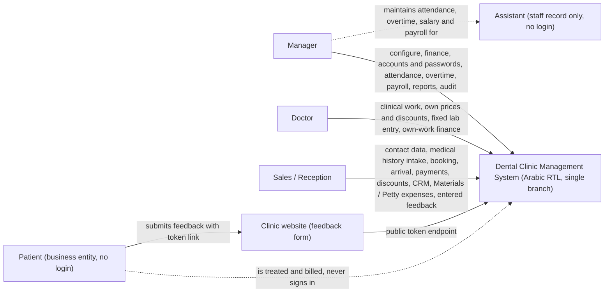

**Note:** the clinic also employs Assistants. They have no login and no application access and are therefore **not** a system actor; the Manager maintains their attendance, overtime, salary and payroll (dotted line).

---

## Diagram 2: High-Level Application Architecture

One modular-monolith API process, one Worker process (same codebase), one managed PostgreSQL database with one schema per module.

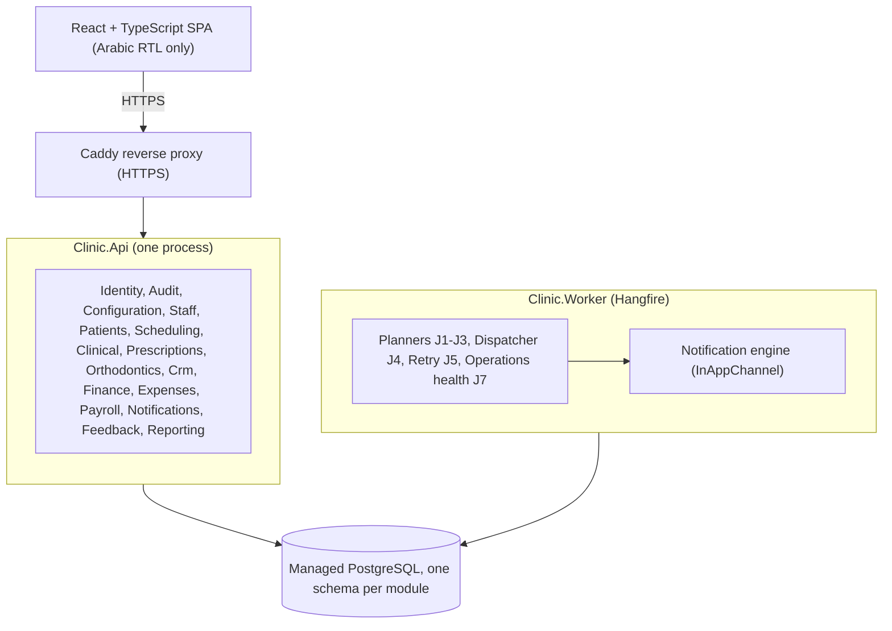

---

## Diagram 3: Module Dependency

Arrows point to the module depended on, and always to a lower level (compile-time architecture tests enforce this). Events flow from a lower publisher to a higher subscriber. Reporting reads other modules read-only and nothing depends on it.

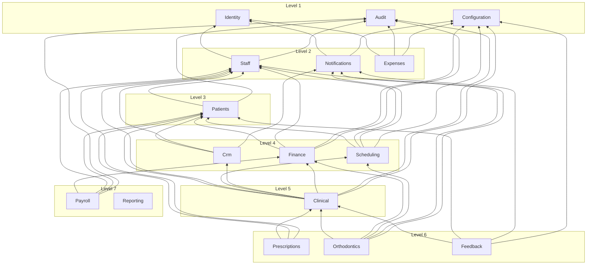

Finance never calls Clinical and subscribes to no events. At Visit finalize, Clinical calls the Finance contract (charges, from the price and the discount snapshot Clinical holds in `pricing_discount_entries`) and the Scheduling contract (release of unused booked time) downward in one transaction. Staff attendance and overtime are inside the Staff module and Payroll reads them downward; the dependency list is unchanged. Cross-module database foreign keys may point in any direction; only code dependencies follow the levels.

---

## Diagram 4: Role / Permission

One operational role per account (database-enforced). Contact-bearing permission keys are never mapped to Doctor. Doctors have no notification inbox in V1. The Manager creates accounts and sets passwords.

**Note:** *Assistant* is a staff type, **not** an application role, and does not appear here. Assistant records, attendance, overtime and payroll are reached only through Manager-only keys (`Staff.Manage`, `Staff.AssistantSalary.Configure`, `Staff.AssistantOvertimeRate.Configure`, `Staff.AssistantOvertime.Manage`, `Staff.Attendance.Manage`, `Payroll.Assistant.ManageAll`).

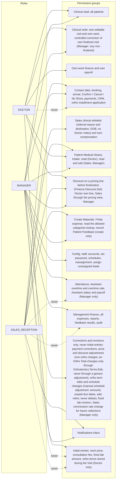

Sales and Manager may Confirm, Cancel and mark No Show. Doctor (own line), Sales and Manager may set a discount before finalization; Sales does it through a pricing view that contains no clinical data. Sales may create Materials / Petty expenses and record Patient Feedback but may read no expense list, report or feedback result. Every permission key is assigned to at least one role.

---

## Diagram 5: Patient Lifecycle

Lead to feedback. A lead-sourced patient keeps the lead's Original Sales Employee (`patient_source = Lead`); a directly registered patient is `WalkIn` / Direct, has **no Original Sales Employee** and generates **zero Sales commission** (no pool). The structured Medical History Intake is collected separately by Sales / Reception, before the Doctor consultation when possible; it never blocks booking. **Arrival flow:** on the day, Sales records the patient's **arrival** (an event, not a status) → the Doctor sees a queue derived from arrivals → the Doctor starts the Visit → the Appointment becomes In Treatment and the patient leaves the queue. There is no Arrived or Waiting status.

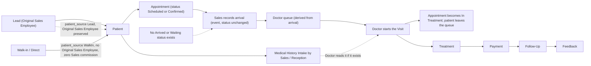

---

## Diagram 6: Doctor Treatment Workflow

The Doctor's visit flow with all procedure branches. Each Doctor enters the **Price** for their own work; the **Discount** (fixed EGP) may be set by the Doctor, Sales or Manager before finalization; the total is Price − Discount. For Implant, Fixed and Removable Prosthetics the Doctor also enters the **initial** fixed lab amount once per case, before the first such charge can be finalized (an unknown Fixed Lab is never treated as zero; the Manager may only revise it later). The Manager has no initial-price authority. Charges are created when the Visit is finalized.

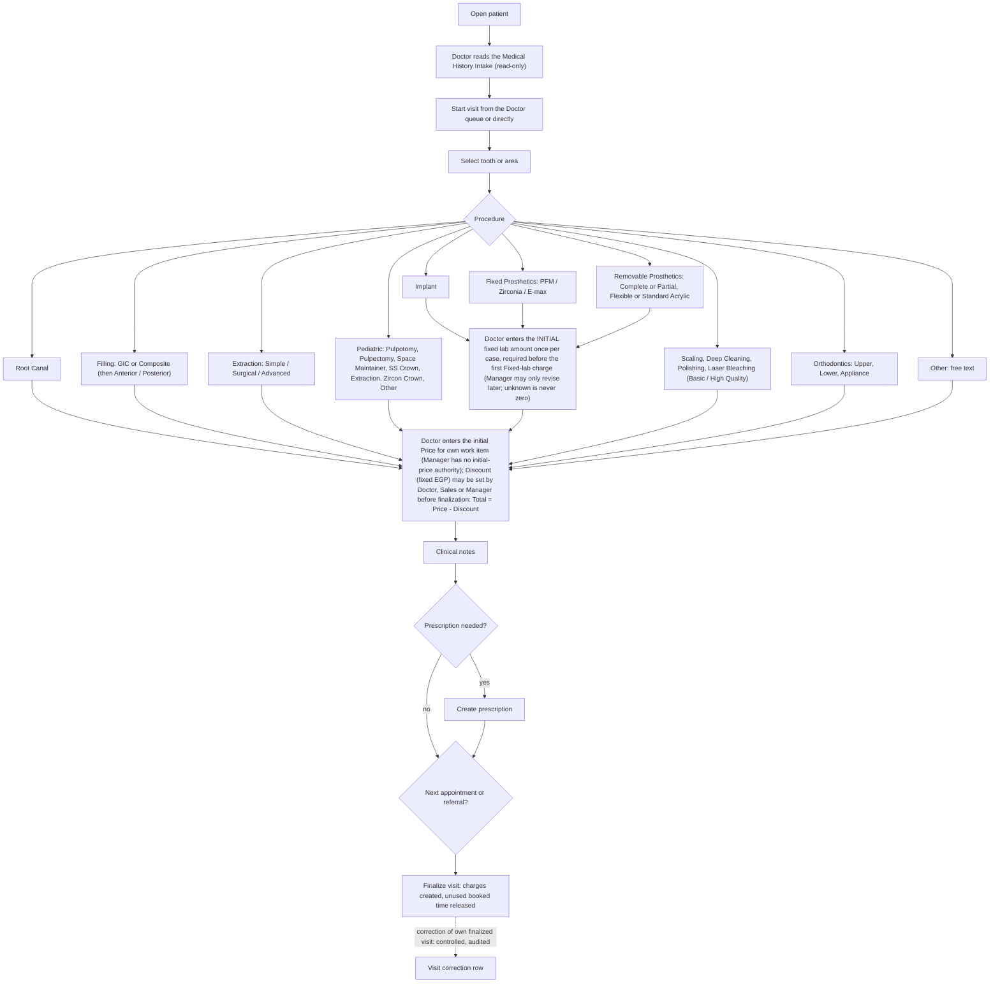

---

## Diagram 7: Root Canal Workflow

A root canal is one treatment case that may span several visits. Completed steps persist and are visible to other Doctors, who can read but not modify them.

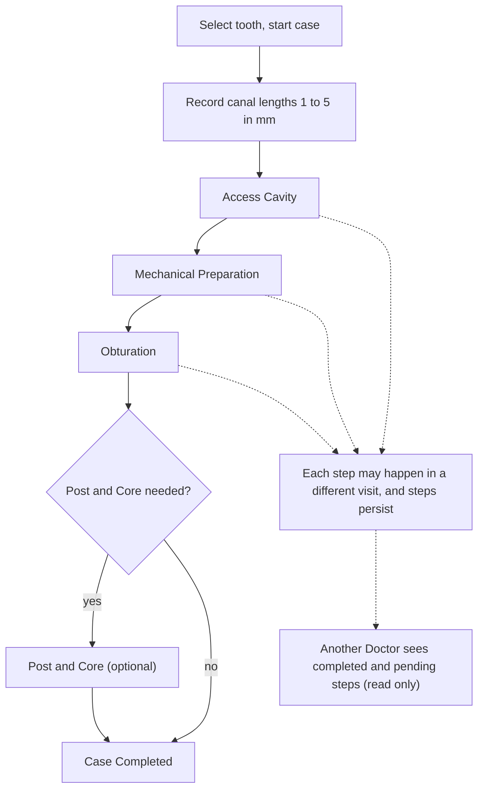

---

## Diagram 8: Appointment Workflow

Exactly seven statuses (Scheduled, Confirmed, In Treatment, Completed, Cancelled, No Show, Rescheduled). **Arrival is an event recorded by Sales** (`appointment_arrivals`), not a status; the Doctor queue is derived from arrivals (the arrival flow is drawn in Diagram 5). Duration is entered manually and overlapping appointments are allowed. A change to date, time or Doctor never overwrites: the old appointment becomes Rescheduled and a new one points back to it. Sales and Manager may Confirm, Cancel and mark No Show.

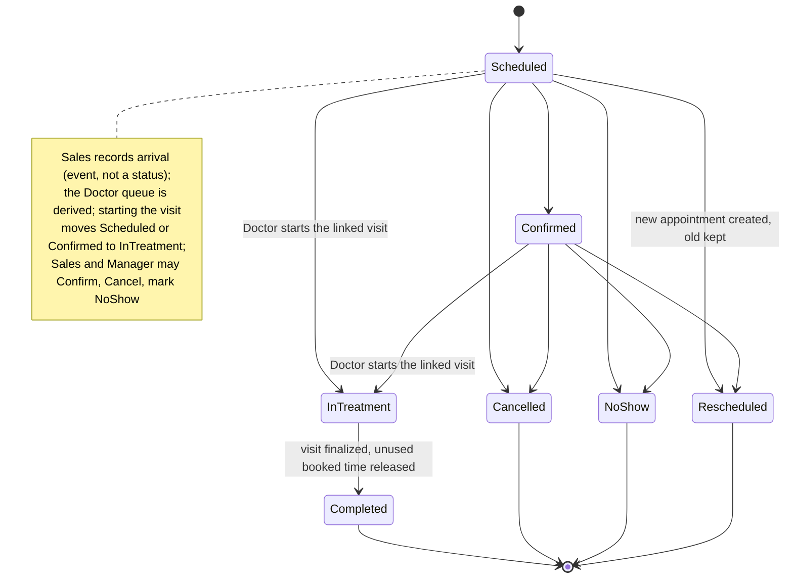

---

## Diagram 9: Doctor Weekly Availability

The Manager publishes each Doctor's weekly availability. Sales books inside published ranges with a manually entered duration; overlapping appointments are allowed. When a Visit ends early, the unused booked time becomes available again.

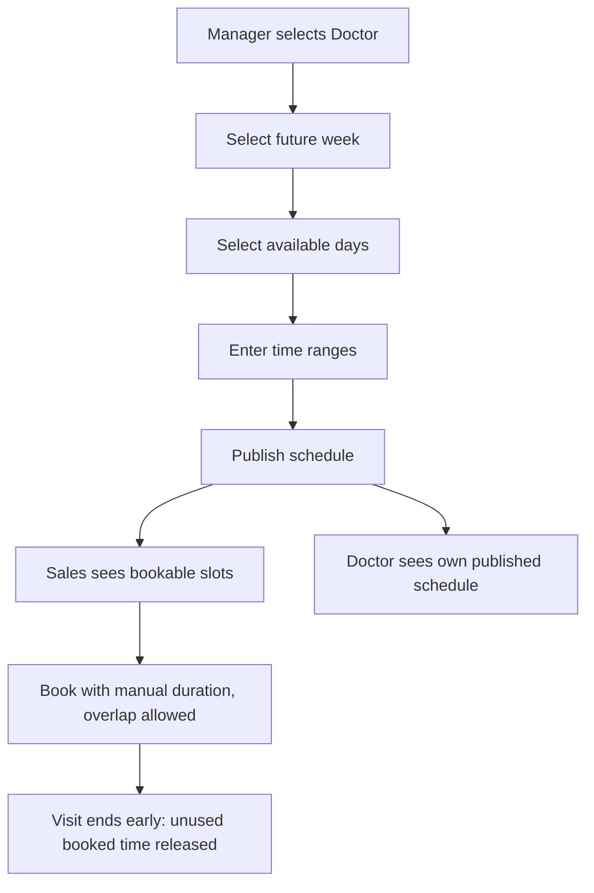

---

## Diagram 10: Implant Workflow

The Doctor chooses exactly one healing period (1 to 6 months), enters the single fixed lab for the case, and picks the next appointment, which appears for the Doctor, the Sales team and the calendar and triggers a Sales reminder the day before.

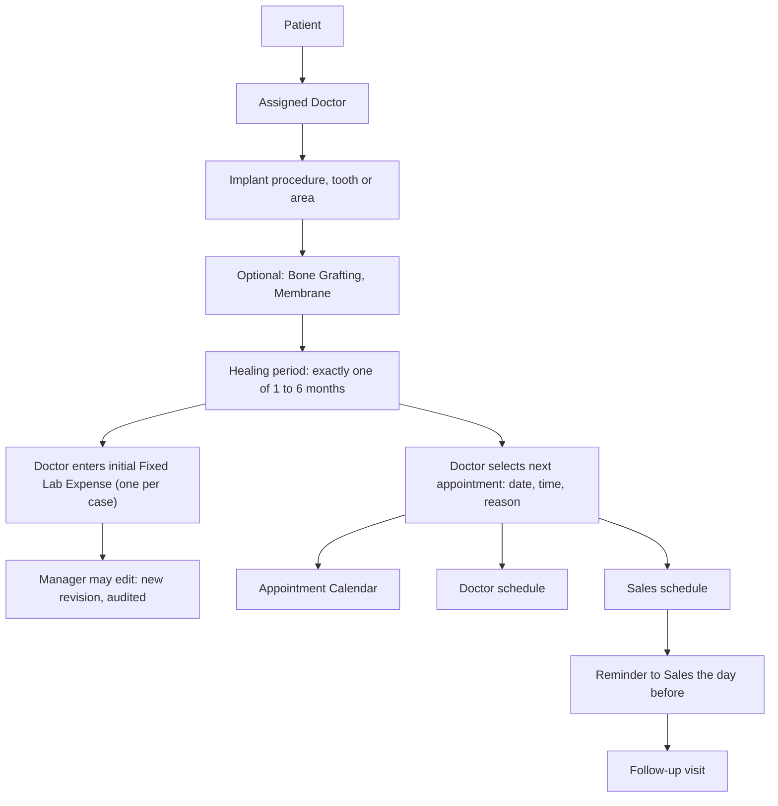

---

## Diagram 11: Orthodontic Workflow

The **Doctor** stores the initial Gross Total, Deposit and Months during the editable Visit (Manager and Sales cannot); nothing else exists yet. At Visit finalization the Discount is snapshotted, the Effective Ortho Total (Gross − Discount = Charge Billed) is fixed, the Deposit is validated against it, the Charge is established and the equal installments are generated once from Effective − Deposit. Payments are allocated to the single orthodontic charge, and Sales or Manager manually applies them to installments. Afterwards `Orthodontics.Terms.Edit` is the **only** route that changes the terms: an increase adds one positive difference installment (the Discount is not re-applied); a decrease is rejected in V1; a Deposit or Months change regenerates, adds, removes and redistributes **nothing** automatically — the case needs schedule adjustment until the Manager, in one atomic batch, revises amounts and unpaid due dates, adds future installments and retires unpaid ones so that Deposit + Σ active installments = Effective Ortho Total and the active regular installments equal the Number of Months. Paid history is never changed; generic price or discount corrections are refused.

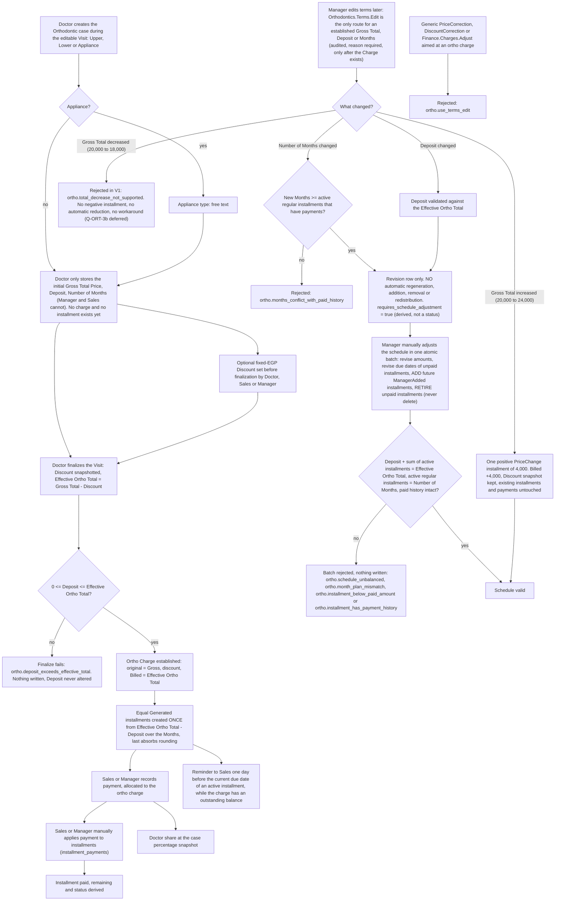

---

## Diagram 12: Referral Workflow

A Doctor referral appears to Sales automatically and notifies Sales. Sales works it through the confirmed statuses.

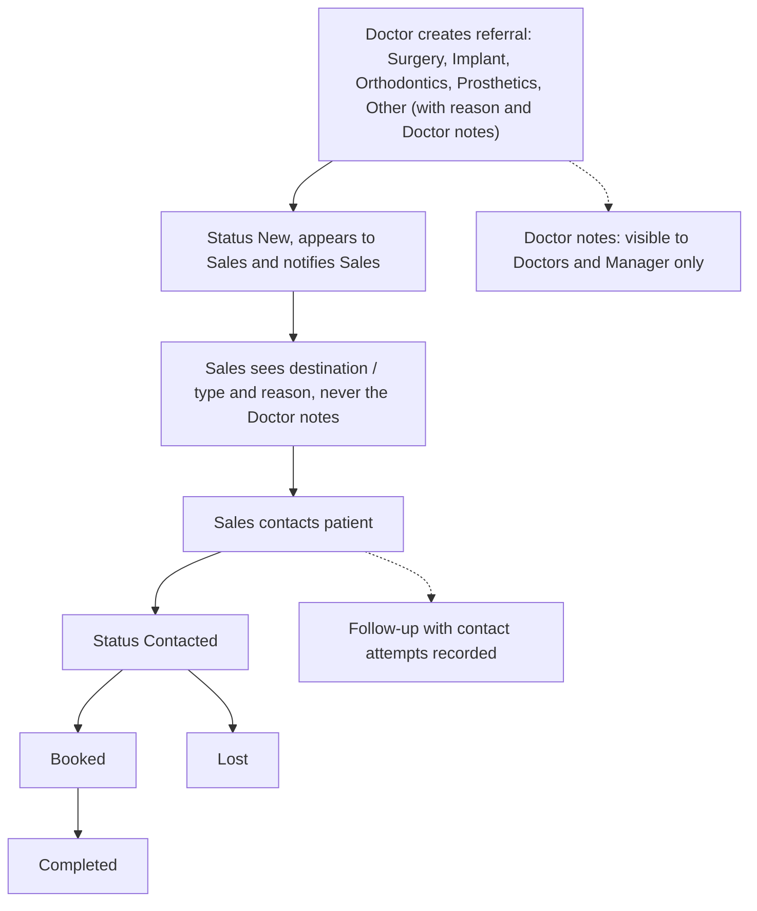

Sales / Reception may see the referral destination / type and reason (Q-PRV-1) but **never the referring Doctor's notes**; Sales still sees no clinical notes or financial shares.

---

## Diagram 13: Prescription Workflow

Editable while the visit is not finalized. After finalization the record is protected; only the Doctor's controlled, audited correction of their own record is allowed (no Manager approval, visit not reopened). The printable model contains no patient contact data.

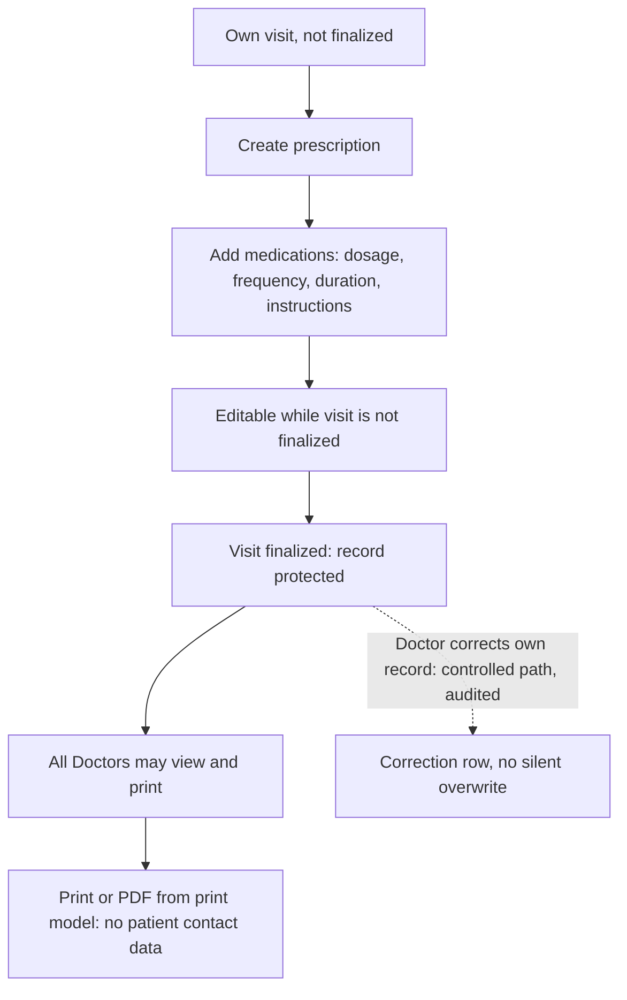

---

## Diagram 14: Finance Workflow

Charges are created at Visit finalize from Price − Discount (the discount may have been set by the Doctor, Sales or Manager; setter and role are kept). Each payment is manually allocated to charges; any remainder becomes Patient Credit. General-lab work is recognized immediately at the lab rate on the allocation date; fixed-lab work follows the Lab-First waterfall (Diagram 15). Manager-only corrections are new ledger rows.

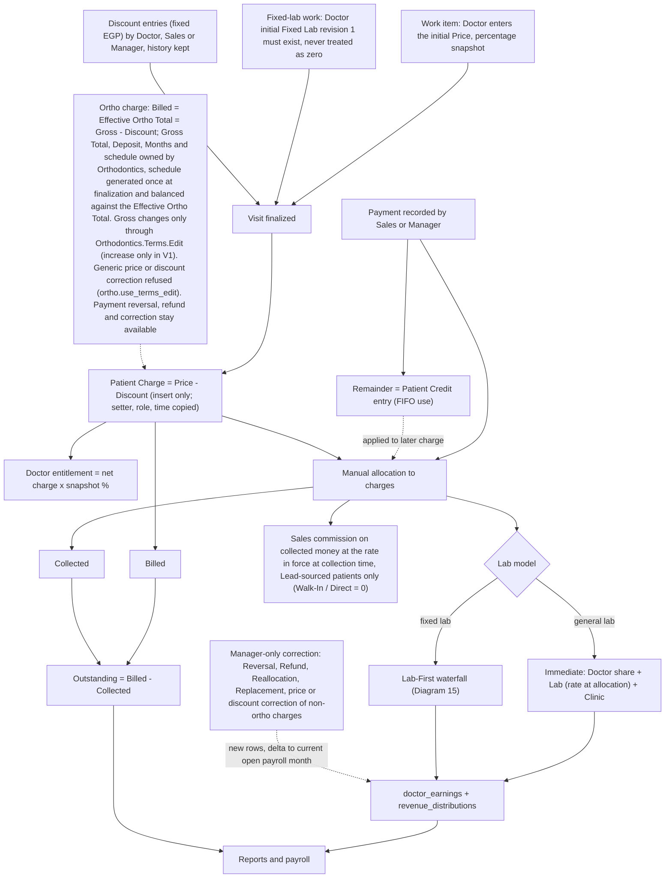

Consultation charges produce no earning or distribution and are Clinic revenue.

---

## Diagram 15: Lab Expense Workflow

Two lab models. Neither reduces the Doctor's entitlement, but a fixed lab is recovered first from collections (Lab-First). The diagram shows the fixed-lab flow: payment → Lab funding priority → Doctor entitlement accrual → pending entitlement if needed → Doctor settlement → Clinic remainder; a Manager revision only emits delta rows. The Doctor's initial Fixed Lab (revision 1) must exist before the first Fixed-lab charge.

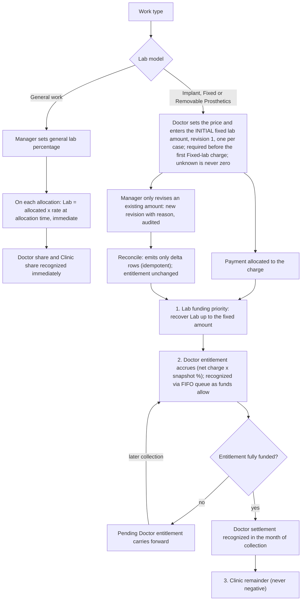

---

## Diagram 16: Doctor Payroll Workflow

Payroll is monthly (calendar month): Draft, Finalized, Paid. It aggregates recognized Doctor Earnings by `recognized_at`. A later rate change never recalculates a payroll.

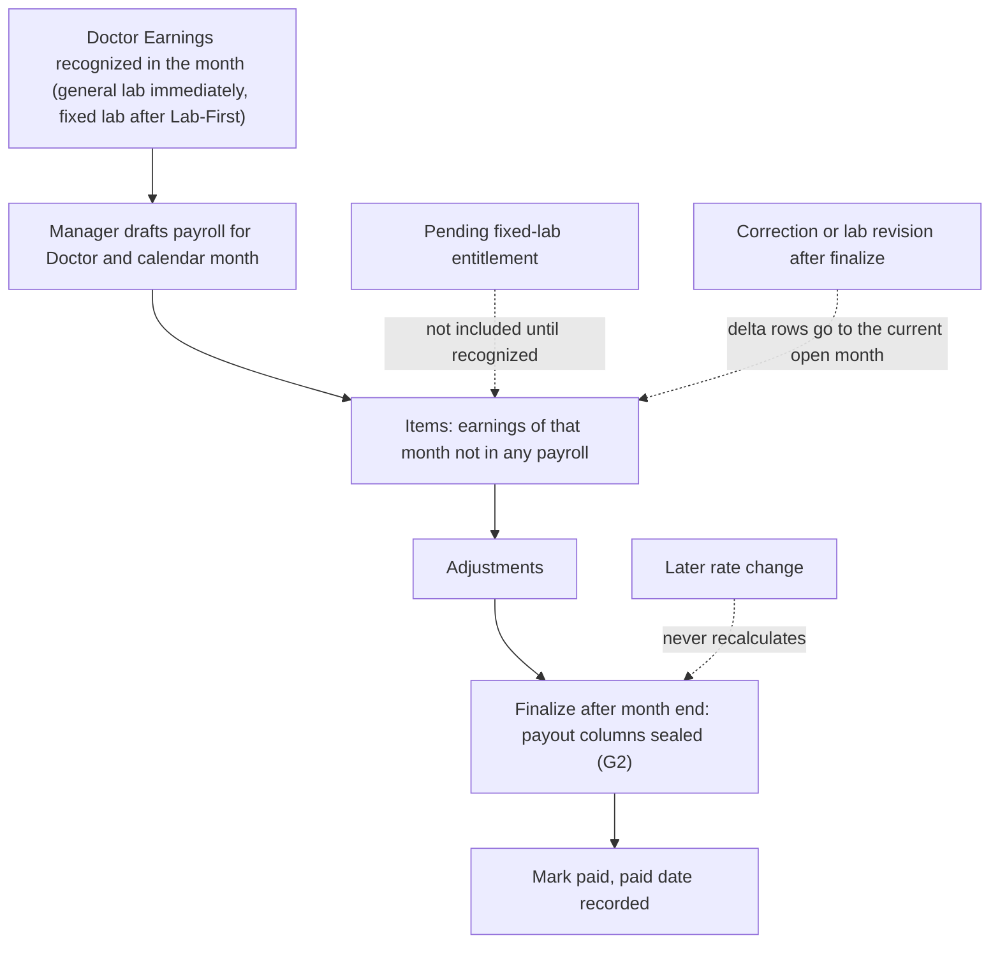

---

## Diagram 17: Sales Payroll Workflow

Monthly payroll. Commission base is **collected money** after discount (net allocations). Lead-sourced patients earn the Original Sales Employee's commission at the **rate in force at each collection** (effective-dated rate history, snapshotted on each commission item; a Manager rate change applies to future collections only and nothing is recalculated) for allocations before that employee's deactivation. **Walk-In / Direct collections generate zero commission and there is no pool.** Attendance is recorded but deducts nothing.

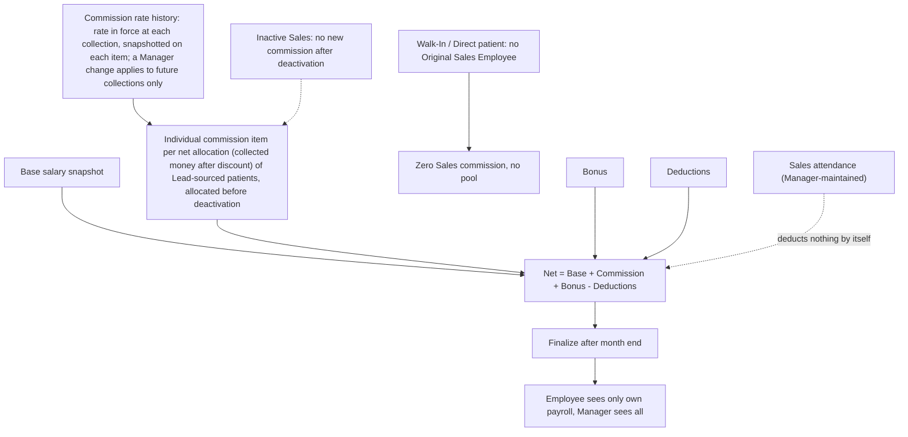

---

## Diagram 18: Clinic Operating Expense Workflow

Expenses reduce the Clinic result only, never a Doctor share. **Sales may only create** Materials / Medical Supplies and Petty / Miscellaneous expenses (reading the allowed categories through a read-only lookup; no category management, list, edit or analytics); the creator is never overwritten by a Manager edit; the Manager sees, edits (audited) and reports all expenses. There is no Finalized state and no attachment.

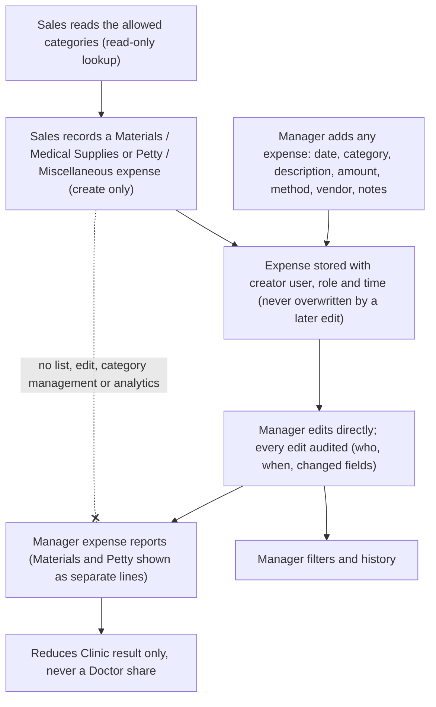

---

## Diagram 19: Notification / Background Job Workflow

Planners and events enqueue deduplicated rows. The dispatcher handles each row in its own transaction, so one failure never rolls back the others. Only Sales and Manager read notifications. A follow-up with no responsible Sales employee is skipped and only counted by J7. Attendance and overtime create no notification.

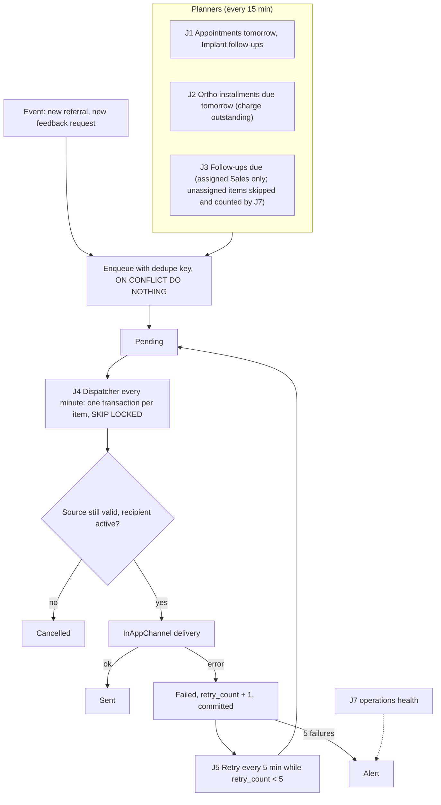

---

## Diagram 20: Feedback Workflow

**Two paths** write the same `feedback_entries` table. (1) Website token path: Visit Completed creates a feedback request; Sales sees it and sends the unique link; the patient submits on the clinic website with the unguessable token (no login, no expiry); the entry has source `PatientWeb`. (2) Sales-entered path: Sales records the Patient's feedback about a Doctor directly; the entry has source `SalesEntered` and the actor. When it concerns a Visit that has a request, the entry **links that request and the request becomes Submitted** (the public link then answers already-submitted); general feedback has no Visit and no request. **At most one accepted result exists per request**, whichever path arrives first. Only the Manager reads results. Automated channels are future work behind a channel abstraction.

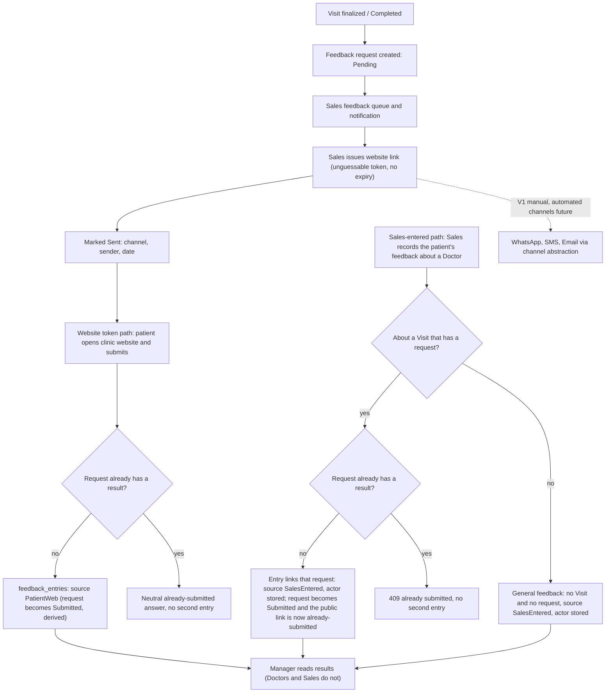

The feedback link does not expire; no timeout job exists.

---

## Diagram 21: Deployment Architecture

One Linux Droplet (DigitalOcean, Frankfurt; about 2 vCPU / 4 GB, configurable) running Docker, one Managed PostgreSQL, independent encrypted off-site backups, and external monitoring. RPO 5 minutes, RTO 4 hours for the realistic failures (loss of the whole provider account is the documented exception). The Clinic Manager, as a person, holds the recovery keys (storage locations OPS-1 are **DEFERRED**). After any restore, `post-restore-lockdown` locks every non-Manager account until the Manager sets passwords.

```mermaid
flowchart TB
    NET["Internet"] -->|"443 HTTPS, 80 redirect"| WEB
    subgraph VM["DigitalOcean Droplet, Frankfurt, about 2 vCPU / 4 GB, configurable (Docker)"]
        WEB["web: Caddy + SPA"] --> API["api"]
        WRK["worker: Hangfire (dashboard on localhost only)"]
        MIG["migrator (deploy time only)"]
        BKP["backup (nightly one-shot)"]
    end
    API -->|"TLS verify-full"| PG[("DigitalOcean Managed PostgreSQL, Frankfurt, point-in-time recovery")]
    WRK --> PG
    MIG --> PG
    BKP --> PG
    BKP -->|"age-encrypted, write-only"| OFF["Off-site object-locked storage, different account"]
    KEYS["Recovery keys held by the Clinic Manager as a person (storage locations OPS-1 DEFERRED)"] -.->|"decrypt on restore"| OFF
    MON["External uptime and heartbeat monitor"] -.-> WEB
    VM -.->|"heartbeats, scrubbed errors"| MON
    GH["GitHub Actions"] -->|"forced-command SSH"| VM
    RST["Restore: post-restore-lockdown locks non-Manager accounts, Manager sets passwords"] -.-> PG
```

---

## Diagram 22: Database ERDs (four parts)

Relationships and key columns only. DATABASE_DESIGN.md is the schema of record.

### 22a Identity / Security

Accounts are created by the Manager; passwords are set by the Manager (hash only, no reset tokens). Assistants (no account) carry the Manager-maintained attendance and overtime tables; attendance also covers Sales employees.

```mermaid
erDiagram
    USERS ||--|| USER_ROLES : "one role per account"
    ROLES ||--o{ USER_ROLES : has
    ROLES ||--o{ ROLE_PERMISSIONS : grants
    PERMISSIONS ||--o{ ROLE_PERMISSIONS : in
    USERS ||--o| DOCTORS : "staff link (doctors.user_id NOT NULL, unique)"
    USERS ||--o| SALES_EMPLOYEES : "staff link (sales_employees.user_id NOT NULL, unique)"
    SALES_EMPLOYEES ||--|{ SALES_COMMISSION_RATE_HISTORY : "revision 1 at creation; current = latest; future collections only"
    USERS ||--o{ SALES_COMMISSION_RATE_HISTORY : "set by Manager"
    ASSISTANTS ||--o{ ATTENDANCE_RECORDS : "Manager-maintained"
    SALES_EMPLOYEES ||--o{ ATTENDANCE_RECORDS : "Manager-maintained"
    ASSISTANTS ||--o{ ASSISTANT_OVERTIME_ENTRIES : "void-only entries"
    ATTENDANCE_RECORDS |o--o| ASSISTANT_OVERTIME_ENTRIES : "optional link, same Assistant and date (composite FK on declared UNIQUE)"
    USERS ||--o{ ATTENDANCE_RECORDS : "recorded by Manager"
    USERS |o--o{ AUDIT_LOG : acts
    USERS {
        uuid id PK
        string user_name
        string password_hash
        bool is_active
    }
    DOCTORS {
        uuid id PK
        uuid user_id
        numeric current_percentage
        bool is_active
    }
    SALES_EMPLOYEES {
        uuid id PK
        uuid user_id
        timestamptz deactivated_at
        bool is_active
    }
    SALES_COMMISSION_RATE_HISTORY {
        uuid id PK
        int revision_number
        numeric commission_percentage "rate, history only, insert-only"
        timestamptz effective_from
    }
    ASSISTANTS {
        uuid id PK
        numeric current_salary
        numeric overtime_hourly_rate
        bool is_active
    }
    ATTENDANCE_RECORDS {
        uuid id PK
        date attendance_date
        text status "Present, Late, Absent"
        time check_in_time
        time check_out_time
    }
    ASSISTANT_OVERTIME_ENTRIES {
        uuid id PK
        date work_date
        uuid attendance_record_id "nullable"
        numeric approved_hours
        numeric hourly_rate_snapshot
        numeric amount
        timestamptz voided_at
    }
    AUDIT_LOG {
        bigint id PK
        string action
        string entity_type
        bool is_restricted
    }
```

### 22b Scheduling / CRM

`PATIENT_MEDICAL_HISTORIES` (Patients module, 0..1 per patient). `APPOINTMENT_ARRIVALS` is an insert-only event table. Leads and Follow-Ups carry a responsible Sales employee with history; NULL means unassigned. `patient_source` is WalkIn / Direct or Lead. `FEEDBACK_ENTRIES` holds both feedback paths; referral `notes` are not Sales-visible.

```mermaid
erDiagram
    PATIENTS ||--|| PATIENT_CONTACTS : "1 to 1"
    PATIENTS ||--o| PATIENT_MEDICAL_HISTORIES : "0..1 intake"
    SALES_EMPLOYEES |o--o{ PATIENT_CONTACTS : "original sales employee, only when patient_source is Lead (WalkIn / Direct has none)"
    PATIENTS ||--o{ PATIENT_DOCTOR_ASSIGNMENTS : history
    DOCTORS ||--o{ PATIENT_DOCTOR_ASSIGNMENTS : "current or previous"
    DOCTORS ||--o{ AVAILABILITY_WEEKS : has
    AVAILABILITY_WEEKS ||--o{ AVAILABILITY_RANGES : contains
    PATIENTS ||--o{ APPOINTMENTS : has
    DOCTORS ||--o{ APPOINTMENTS : attends
    APPOINTMENTS |o--o| APPOINTMENTS : "previous_appointment"
    APPOINTMENTS ||--o{ APPOINTMENT_ARRIVALS : "arrival events, Sales only"
    SALES_EMPLOYEES ||--o{ LEADS : "original owner"
    SALES_EMPLOYEES |o--o{ LEADS : "responsible owner (NULL = unassigned)"
    LEADS ||--o{ RESPONSIBILITY_HISTORY : "reassignment history"
    LEADS |o--o| PATIENTS : "converted to"
    PATIENTS ||--o{ REFERRALS : has
    DOCTORS ||--o{ REFERRALS : creates
    PATIENTS |o--o{ FOLLOW_UPS : about
    SALES_EMPLOYEES |o--o{ FOLLOW_UPS : "assigned (NULL = unassigned)"
    FOLLOW_UPS ||--o{ FOLLOW_UP_CONTACT_ATTEMPTS : "append only"
    PATIENTS |o--o{ NOTIFICATIONS : "related, optional"
    PATIENTS ||--o{ FEEDBACK_REQUESTS : has
    VISITS ||--o| FEEDBACK_REQUESTS : "created in the finalize transaction"
    FEEDBACK_REQUESTS |o--o| FEEDBACK_ENTRIES : "at most one result per request, either source; Sales-entered Visit feedback links the request"
    PATIENTS ||--o{ FEEDBACK_ENTRIES : "about a Doctor"
    DOCTORS ||--o{ FEEDBACK_ENTRIES : receives
    REFERRALS {
        uuid id PK
        text reason "visible to Sales"
        text notes "Doctor and Manager only"
    }
    FEEDBACK_REQUESTS {
        uuid id PK
        uuid visit_id "unique"
        timestamptz link_sent_at "state derived: Pending, Sent, Submitted"
    }
    FEEDBACK_ENTRIES {
        uuid id PK
        text source "PatientWeb or SalesEntered"
        uuid visit_id "NULL = general feedback"
        uuid feedback_request_id "NULL = general feedback; unique"
        smallint rating
        uuid recorded_by_user_id "SalesEntered only"
    }
    APPOINTMENTS {
        uuid id PK
        timestamptz start_at
        int duration_minutes
        text status
        timestamptz visit_ended_at
    }
    FOLLOW_UPS {
        uuid id PK
        text status "New, Contacted, NoResponse, FollowedUp"
    }
    PATIENT_CONTACTS {
        uuid patient_id PK
        text patient_source "WalkIn (includes Direct) or Lead"
    }
```

### 22c Clinical

`PRICING_DISCOUNT_ENTRIES` is the insert-only discount history of a Visit's pricing lines (Doctor, Sales or Manager as setter).

```mermaid
erDiagram
    PATIENTS ||--o{ VISITS : has
    DOCTORS ||--o{ VISITS : performs
    VISITS |o--o| APPOINTMENTS : "optional link"
    PATIENTS ||--o{ TREATMENT_CASES : has
    PROCEDURE_TYPES ||--o{ TREATMENT_CASES : "type of"
    VISITS ||--o{ TREATMENT_RECORDS : contains
    VISITS ||--o{ VISIT_CORRECTIONS : "controlled Doctor correction"
    TREATMENT_CASES ||--o{ TREATMENT_RECORDS : "spans visits"
    TREATMENT_CASES ||--o{ CASE_WORK_ITEMS : "billable work"
    DOCTORS ||--o{ CASE_WORK_ITEMS : "performing doctor prices own work"
    VISITS |o--o{ PRICING_DISCOUNT_ENTRIES : "consultation line (consultation_visit_id)"
    CASE_WORK_ITEMS |o--o{ PRICING_DISCOUNT_ENTRIES : "work item line (case_work_item_id); XOR with the consultation line"
    TREATMENT_RECORDS ||--o| CASE_WORK_ITEMS : "one work item per priced record"
    DOCTORS ||--o{ VISIT_CORRECTIONS : "own Visits only (composite FK visit_id, doctor_id)"
    TREATMENT_CASES ||--o{ TREATMENT_STEPS : "root canal"
    TREATMENT_CASES ||--o{ ROOT_CANAL_MEASUREMENTS : canals
    TREATMENT_CASES |o--o| IMPLANT_DETAILS : implant
    TREATMENT_CASES |o--o| ORTHO_CASES : orthodontic
    PATIENTS ||--o{ PRESCRIPTIONS : has
    VISITS ||--o{ PRESCRIPTIONS : has
    PRESCRIPTIONS ||--o{ PRESCRIPTION_ITEMS : contains
    CASE_WORK_ITEMS {
        uuid id PK
        uuid treatment_record_id "NOT NULL, unique"
        uuid performing_doctor_id
        numeric doctor_percentage_snapshot
        numeric entered_price
    }
    PRICING_DISCOUNT_ENTRIES {
        uuid id PK
        text pricing_line_kind "WorkItem or Consultation"
        uuid case_work_item_id "nullable, XOR"
        uuid consultation_visit_id "nullable, XOR"
        int entry_seq "optimistic token, highest = current"
        numeric amount "fixed EGP, no percentage"
        text set_by_role "DOCTOR, SALES_RECEPTION, MANAGER"
        timestamptz set_at
    }
    VISIT_CORRECTIONS {
        uuid id PK
        uuid visit_id
        uuid correcting_doctor_id "must be the Visit doctor"
        text record_type
    }
```

### 22d Financial (including Orthodontics and Payroll)

`ASSISTANTS` (staff schema) and `ASSISTANT_PAYROLLS` (payroll schema) have deliberately **no** link to any user or identity table. Assistant payroll = Base Pay + overtime items. There are no attribution-hold tables and **no Walk-In pool tables**.

```mermaid
erDiagram
    CASE_WORK_ITEMS |o--o| PATIENT_CHARGES : "one charge per work item (consultation charge has none)"
    PATIENTS ||--o{ PATIENT_CHARGES : billed
    PATIENTS ||--o{ PAYMENTS : pays
    PAYMENTS ||--o{ PAYMENT_ALLOCATIONS : "signed split"
    PAYMENTS ||--o{ PATIENT_CREDIT_ENTRIES : "remainder"
    PATIENTS ||--o{ PATIENT_CREDIT_ENTRIES : "credit ledger"
    PAYMENTS ||--o{ PAYMENT_CORRECTIONS : "Manager-only"
    PATIENT_CHARGES ||--o{ PAYMENT_ALLOCATIONS : receives
    PAYMENTS |o--o{ DISTRIBUTION_EVENTS : "Collection, CreditApplication"
    PAYMENT_CORRECTIONS |o--o{ DISTRIBUTION_EVENTS : "Correction"
    FIXED_LAB_REVISIONS |o--o{ DISTRIBUTION_EVENTS : "FixedLabRevision (Manager revisions)"
    DISTRIBUTION_EVENTS ||--o{ DOCTOR_ENTITLEMENTS : "event is the parent"
    DISTRIBUTION_EVENTS ||--o{ DOCTOR_EARNINGS : "event is the parent"
    DISTRIBUTION_EVENTS ||--o{ REVENUE_DISTRIBUTIONS : "event is the parent"
    PAYMENT_ALLOCATIONS ||--o{ DOCTOR_ENTITLEMENTS : "0..N: initial row plus correction deltas; none for consultation"
    PATIENT_CHARGES ||--o{ DOCTOR_ENTITLEMENTS : "0..N via the allocation (composite FK), never exactly one"
    DOCTORS ||--o{ DOCTOR_ENTITLEMENTS : "entitled"
    PAYMENT_ALLOCATIONS ||--o{ DOCTOR_EARNINGS : "recognizes, lagging for fixed lab"
    DOCTORS ||--o{ DOCTOR_EARNINGS : earns
    PAYMENT_ALLOCATIONS ||--o{ REVENUE_DISTRIBUTIONS : "lab and clinic, 1..N for treatment and ortho"
    PATIENT_CHARGES ||--o{ REVENUE_DISTRIBUTIONS : "charge and case consistency (composite FK)"
    PATIENT_CHARGES ||--o{ CHARGE_ADJUSTMENTS : "Manager corrections, ortho charges only OrthoTermsChange increase"
    TREATMENT_CASES |o--o| FIXED_LAB_EXPENSES : "one per fixed-lab case"
    FIXED_LAB_EXPENSES ||--|{ FIXED_LAB_REVISIONS : "revision 1 Doctor, later Manager"
    ORTHO_CASES |o--o| PATIENT_CHARGES : "one ortho charge, set at Visit finalization"
    ORTHO_CASES ||--|{ ORTHO_TERM_REVISIONS : "revision 1 Doctor, later Manager"
    ORTHO_CASES ||--o{ ORTHO_INSTALLMENTS : "schedule, generated once at finalization"
    ORTHO_INSTALLMENTS ||--o{ ORTHO_INSTALLMENT_REVISIONS : "amount, due date and active revisions; never below paid, never deleted"
    ORTHO_INSTALLMENTS ||--o{ INSTALLMENT_PAYMENTS : "manual application"
    PAYMENT_ALLOCATIONS ||--o{ INSTALLMENT_PAYMENTS : consumed
    DOCTORS ||--o{ DOCTOR_PAYROLLS : paid
    DOCTOR_PAYROLLS ||--o{ DOCTOR_PAYROLL_ITEMS : contains
    DOCTOR_EARNINGS ||--o| DOCTOR_PAYROLL_ITEMS : "paid once"
    DOCTOR_PAYROLLS ||--o{ DOCTOR_PAYROLL_ADJUSTMENTS : has
    SALES_EMPLOYEES ||--o{ SALES_PAYROLLS : paid
    SALES_PAYROLLS ||--o{ SALES_PAYROLL_COMMISSION_ITEMS : contains
    PAYMENT_ALLOCATIONS ||--o| SALES_PAYROLL_COMMISSION_ITEMS : "commissioned at most once; none for Walk-In or Direct"
    SALES_COMMISSION_RATE_HISTORY ||--o{ SALES_PAYROLL_COMMISSION_ITEMS : "rate in force at collection time"
    SALES_PAYROLLS ||--o{ SALES_PAYROLL_ADJUSTMENTS : has
    ASSISTANTS ||--o{ ASSISTANT_PAYROLLS : "paid monthly"
    ASSISTANT_PAYROLLS ||--o{ ASSISTANT_PAYROLL_OVERTIME_ITEMS : "overtime items"
    ASSISTANT_OVERTIME_ENTRIES ||--o| ASSISTANT_PAYROLL_OVERTIME_ITEMS : "in at most one payroll"
    EXPENSE_CATEGORIES ||--o{ CLINIC_EXPENSES : classifies
    ASSISTANTS {
        uuid id PK
        text full_name
        numeric current_salary
        boolean is_active
    }
    ASSISTANT_PAYROLLS {
        uuid id PK
        date period_start
        date period_end
        numeric salary_snapshot
        numeric base_pay_amount
        text partial_period_reason
        numeric overtime_amount
        numeric final_amount "base pay + overtime"
        text status "Draft, Finalized, Paid"
    }
    ASSISTANT_PAYROLL_OVERTIME_ITEMS {
        uuid id PK
        numeric approved_hours
        numeric hourly_rate_snapshot
        numeric amount
    }
    PATIENT_CHARGES {
        uuid id PK
        numeric original_price
        numeric discount_amount "set by Doctor, Sales or Manager before finalization"
        numeric final_price "generated: original_price - discount_amount"
        text discount_set_by_role
    }
    CHARGE_ADJUSTMENTS {
        uuid id PK
        numeric amount_delta "signed, Manager only"
        text adjustment_kind "DiscountCorrection or PriceCorrection for non-ortho charges, OrthoTermsChange for ortho charges only"
    }
    DISTRIBUTION_EVENTS {
        uuid id PK
        text event_kind "Collection, CreditApplication, Correction, FixedLabRevision"
        numeric basis_amount
    }
    DOCTOR_ENTITLEMENTS {
        uuid id PK
        numeric amount "signed entitled delta"
        numeric doctor_percentage_applied
    }
    DOCTOR_EARNINGS {
        uuid id PK
        numeric amount
        timestamptz recognized_at
    }
    REVENUE_DISTRIBUTIONS {
        uuid id PK
        uuid charge_id
        numeric lab_amount
        numeric clinic_share
    }
    FIXED_LAB_REVISIONS {
        uuid id PK
        int revision_number
        numeric amount
        text entered_by_role "DOCTOR for revision 1, MANAGER later"
    }
    ORTHO_TERM_REVISIONS {
        uuid id PK
        int revision_number
        numeric gross_total_price "Doctor Gross Total, never decreased in V1"
        text entered_by_role "DOCTOR for revision 1, MANAGER later"
    }
    ORTHO_INSTALLMENTS {
        uuid id PK
        int installment_number
        text origin "Generated, ManagerAdded or PriceChange"
    }
    ORTHO_INSTALLMENT_REVISIONS {
        uuid id PK
        int revision_number
        numeric amount_due
        date due_date
        boolean is_active "false = retired, only when unpaid"
        text source "Generated, ManagerAdded, PriceChange, ManagerEdit, ManagerRetire"
    }
    SALES_PAYROLL_COMMISSION_ITEMS {
        uuid id PK
        uuid payment_allocation_id "unique"
        uuid rate_revision_id
        numeric base_amount
        numeric commission_percentage_applied "snapshot at collection time"
        numeric commission_amount
    }
    SALES_COMMISSION_RATE_HISTORY {
        uuid id PK
        int revision_number
        numeric commission_percentage
        timestamptz effective_from
    }
    CLINIC_EXPENSES {
        uuid id PK
        numeric amount
        uuid created_by_user_id "never overwritten"
        text created_by_role "MANAGER or SALES_RECEPTION"
        timestamptz created_at
        uuid updated_by_user_id
        timestamptz updated_at
    }
    EXPENSE_CATEGORIES {
        uuid id PK
        bool sales_can_record "Materials and Petty only"
    }
```

---

## Diagram 23: Assistant Payroll Workflow

Assistants are a staff record and a payroll expense. They have no account, login, role, notification or application access. The **Manager** records Attendance (one record per day; it deducts nothing and creates no overtime), configures the hourly overtime rate and records approved overtime hours; each entry takes a **rate snapshot** and its amount is hours × snapshot. Base Pay is the salary snapshot for a normal month, or Manager-entered with a reason for a partial month (no /30, no proration). **Final amount = Base Pay + Overtime.** No bonus, deduction or commission exists for Assistants.

```mermaid
flowchart TD
    MGR["Manager (Assistant has no login or application access)"] --> REC["Assistant staff record (Staff.Manage), no user account"]
    MGR --> SAL["Set current salary (Staff.AssistantSalary.Configure), audited"]
    MGR --> RATE["Configure overtime hourly rate (Staff.AssistantOvertimeRate.Configure), audited"]
    MGR --> ATT["Record Attendance: one record per day (Staff.Attendance.Manage)"]
    ATT -.->|"deducts nothing, creates no overtime"| NOP["Attendance alone changes no pay"]
    MGR --> OT["Record approved overtime hours (Staff.AssistantOvertime.Manage)"]
    RATE --> SNAPR["Hourly rate snapshot copied into the entry"]
    OT --> SNAPR
    SNAPR --> AMT["Overtime amount = approved hours x rate snapshot (later rate changes never recalculate)"]
    REC --> CUR["current_salary"]
    SAL --> CUR
    MGR --> DRAFT["Create monthly payroll draft (Payroll.Assistant.ManageAll)"]
    CUR --> SNAP["Salary snapshot copied into the payroll"]
    DRAFT --> SNAP
    SNAP --> BP["Base Pay: salary snapshot for a normal full month; Manager enters it with a reason for a partial month (no /30, no proration)"]
    AMT --> OTI["Overtime items of that month (each entry in at most one payroll)"]
    DRAFT --> OTI
    BP --> FA["Final amount = Base Pay + Overtime"]
    OTI --> FA
    FA --> FIN["Finalize after month end: sealed, never recalculated"]
    FIN --> PAID["Mark paid: paid date recorded"]
    FIN --> EXP["Assistant Payroll Expense (monthly reports: Base Pay and Overtime lines; Daily / Weekly allocate nothing)"]
    PAID --> EXP
    EXP --> RES["Estimated Clinic Operating Result"]
    GR["Clinic Gross Revenue, never reduced by Assistant salary"] --> RES
    SP["Sales payroll"] --> RES
    OE["Clinic Operating Expenses"] --> RES
```

Result = Clinic Gross Revenue − Sales payroll − Assistant Payroll Expense − Clinic Operating Expenses − other Clinic-owned expenses. Doctor Payroll is never subtracted again.

---

## Change history (final Owner review synchronization)

Mermaid **source only**; no PNG, SVG or other rendered output was produced, kept or promised. All 26 sources were parse-validated.

| Diagram | Change |
|---|---|
| 1 | Assistant shown as a Manager-maintained staff record (no login); Sales discounts, Materials / Petty expenses and entered feedback; Doctor fixed lab entry. |
| 4 | Initial entries (price, fee, fixed lab, ortho terms) Doctor only; Manager corrections / revisions only; Discount group now Doctor (own line), Sales and Manager; Sales create-only expense and feedback group; Manager-only attendance / overtime / payroll group; Sales never reaches reports or feedback results. |
| 5 | Arrival → Doctor queue → Visit start → In Treatment flow, without Arrived / Waiting; Walk-In / Direct has no Original Sales Employee and zero commission (`patient_source`). |
| 6 | Doctor price and initial fixed lab entry (Manager has no initial authority); discount by Doctor, Sales or Manager. |
| 8 | Note extended: arrival event, derived queue, status actors. |
| 11 | Initial sequence: Doctor stores Gross / Deposit / Months, optional Discount, finalize, Effective Total, Deposit validation, Charge, one-time equal installments. Manager edit path: increase adds a positive installment, decrease rejected in V1, Deposit / Months edits need manual schedule adjustment (amounts, due dates, add, retire), generic adjustments refused. |
| 12 | Referral Doctor notes hidden from Sales. |
| 14 | Doctor initial price; fixed-lab precondition; commission at collection-time rate; discount entries, setter metadata, Sales commission on collected Lead-sourced money only. |
| 15 | Doctor initial Fixed Lab required first; Fixed-lab flow: Lab funding priority, entitlement accrual, pending entitlement, settlement, Clinic remainder; revision emits delta rows. |
| 17 | Walk-In pool removed; Walk-In / Direct zero commission; commission rate history (future collections only); attendance deducts nothing. |
| 18 | Sales create-only Materials / Petty expense with the allowed-categories lookup; creator preserved; Manager edit and reports. |
| 19 | Unassigned follow-ups skipped (J3), counted by J7. |
| 20 | Website token path and Sales-entered path (linked to the request, or general) into `feedback_entries`; one result per request; Manager-only results. |
| 21 | About 2 vCPU / 4 GB configurable; keys held by the Clinic Manager as a person. |
| 22a | Attendance records and Assistant overtime entries; Sales commission rate history; staff `user_id`. |
| 22b | `patient_source`; nullable responsible Sales; `feedback_requests` / `feedback_entries` linkage (one result per request); `start_at`; referral `notes` Doctor-only. |
| 22c | `pricing_discount_entries` with two direct nullable FKs (XOR), `visit_corrections` composite FK, work item ↔ treatment record 1:1. |
| 22d | Walk-In pool tables removed; Assistant payroll Base Pay + overtime items; expense `created_by_role` / immutable creator and `sales_can_record`; charge `original_price` / `discount_amount` / `final_price`; distribution events are parents of entitlements, earnings and distributions; a charge has 0..N entitlements; Sales commission items with rate snapshot. |
| 23 | Attendance → approved overtime → rate snapshot → overtime amount → monthly payroll (Final = Base Pay + Overtime). |
| 2, 3, 7, 9, 10, 13, 16 | Reviewed; 3 and 9 annotated only in text; no structural change required. |
